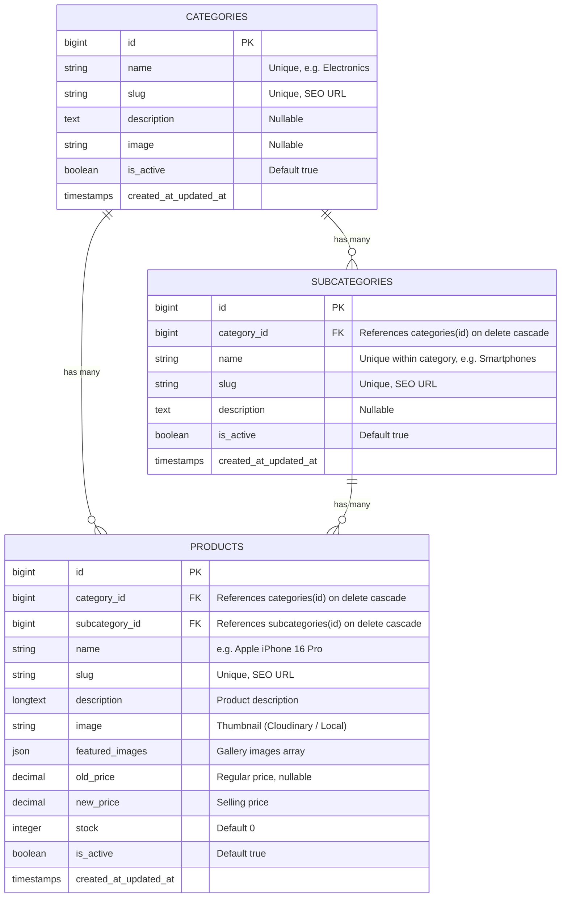

# E-Commerce Platform

A production-grade, full-featured E-Commerce Platform built with **Laravel 11 (PHP 8.3), PostgreSQL, Tailwind CSS, and PHPUnit**.

🌐 **Live Demo (Render):** [https://e-commerce-platform-fca1.onrender.com](https://e-commerce-platform-fca1.onrender.com)  
🧪 **Test Suite:** **115 Passed, 425 Assertions (100% Pass Rate)**

---

## Table of Contents
- [Project Overview](#project-overview)
- [Evaluation Criteria Alignment](#evaluation-criteria-alignment)
- [Default Demo Credentials](#default-demo-credentials)
- [Entity-Relationship Diagram (ERD)](#entity-relationship-diagram-erd)
- [Project Structure](#project-structure)
- [Key Features & Implementation Approach](#key-features--implementation-approach)
- [Technology Stack](#technology-stack)
- [Installation & Local Setup](#installation--local-setup)
- [Docker & Production Deployment](#docker--production-deployment)
- [Application Routes](#application-routes)
- [Automated Testing](#automated-testing)

---

## Project Overview

This application delivers a complete e-commerce experience:
1. **Admin Management Portal:** Full CRUD for Categories, Subcategories, and Products featuring real-time dynamic dependent dropdowns, cross-field validation, and multi-image uploads.
2. **Customer Storefront:** An interactive storefront with product grouping by subcategories, search, filtering, SEO-friendly slug-based product detail pages, and a seamless shopping cart.
3. **High Performance & Problem Solving:** Zero-reload client-side SPA navigation engine, database query optimization with composite B-Tree indexes, and Cloudinary CDN storage with automatic local fallback.

---

## Default Demo Credentials

The database seeder automatically configures ready-to-test accounts:

| Role | Email | Password | Access Level |
|---|---|---|---|
| **System Administrator** | `admin@example.com` | `Admin@123456` | Full Admin Portal Access (`/admin`) |
| **Alternative Admin** | `admin@admin.com` | `password` | Full Admin Portal Access (`/admin`) |
| **Customer User** | `customer@example.com` | `Customer@123456` | Customer Storefront & Cart (`/profile`) |
| **Demo User** | `user@example.com` | `password` | Customer Storefront & Cart |

---

## Entity-Relationship Diagram (ERD)



---

## Project Structure

```
├── app/
│   ├── Http/
│   │   ├── Controllers/
│   │   │   ├── CartController.php          # Shopping cart session management & checkout
│   │   │   ├── CategoryController.php      # Admin Category CRUD operations
│   │   │   ├── DashboardController.php     # Admin dashboard analytics & stats
│   │   │   ├── ProductController.php       # Admin Product CRUD & image handling
│   │   │   ├── StorefrontController.php   # Public catalog, filters & product details
│   │   │   ├── SubcategoryController.php   # Admin Subcategory CRUD & AJAX endpoint
│   │   │   └── WebAuthController.php       # Authentication (Login, Register, Profile)
│   │   ├── Middleware/
│   │   │   ├── ApiRequestLogger.php        # HTTP console logger for request metadata
│   │   │   └── JwtAuthenticate.php         # JWT token authentication middleware
│   │   └── Requests/
│   │       ├── CategoryRequest.php         # Category validation rules & messages
│   │       ├── ProductRequest.php          # Product & cross-validation rules
│   │       └── SubcategoryRequest.php      # Subcategory validation rules
│   ├── Models/
│   │   ├── Category.php                    # Eloquent model with subcategories/products relations
│   │   ├── Product.php                     # Product model with prices, discounts & relations
│   │   ├── Subcategory.php                 # Subcategory model with category/products relations
│   │   └── User.php                        # User model with role checks (isAdmin)
│   ├── Providers/
│   │   └── AppServiceProvider.php          # View composers & optimized category sharing
│   ├── Services/
│   │   └── FileUploadService.php           # Cloudinary CDN upload with local fallback
│   └── Traits/
│       └── ApiResponse.php                 # Standardized JSON response envelope
├── database/
│   ├── factories/                          # Model factories for rapid testing
│   ├── migrations/                         # Schema definitions & composite indexes
│   └── seeders/
│       ├── DatabaseSeeder.php              # Master seeder with admin & client users
│       └── EcommerceCatalogSeeder.php      # Demo categories, subcategories & products
├── docker/
│   ├── entrypoint.sh                       # Container startup, migration & permission setup
│   ├── nginx.conf                          # Production Nginx reverse proxy configuration
│   └── php.ini                             # Production PHP-FPM upload & memory settings
├── resources/
│   └── views/
│       ├── admin/                          # Admin CRUD views (Categories, Subcategories, Products)
│       ├── layouts/                        # Base Blade layouts (app.blade.php & admin.blade.php)
│       ├── partials/                       # Reusable partials (toast notifications, navbars)
│       └── storefront/                     # Storefront views (index, catalog, product show, cart)
├── routes/
│   ├── api.php                             # RESTful API endpoints
│   └── web.php                             # Web routes (Storefront, Cart, Admin, Auth)
└── tests/
    ├── Feature/                            # Feature test suites (CRUD, Cart, Storefront, Auth)
    └── Unit/                               # Model relationships & calculation unit tests
```

---

## Key Features & Implementation Approach

### 1. Dynamic Dependent Dropdown (AJAX)
* In product creation and edit forms, changing the **Category** dropdown fires an asynchronous `fetch()` to `/admin/categories/{category}/subcategories`.
* The subcategory dropdown updates dynamically without full-page reloads, populated with only relevant subcategories belonging to the chosen parent.

### 2. Strict Cross-Validation Rule
* Beyond frontend dynamic dropdowns, the backend enforces cross-relationship integrity in `ProductRequest`:
  ```php
  'subcategory_id' => [
      'required',
      Rule::exists('subcategories', 'id')->where('category_id', $this->category_id),
  ],
  ```
* This prevents selecting or injecting a subcategory that does not belong to the selected category.

### 3. Dual-Storage Architecture (Cloudinary + Local Disk Fallback)
* Handled through `FileUploadService`:
  - When Cloudinary credentials (`CLOUDINARY_NAME`, `CLOUDINARY_API_KEY`, `CLOUDINARY_API_SECRET`) are present, images upload to **Cloudinary CDN** with permanent secure URLs.
  - If Cloudinary credentials are absent or network is unavailable, uploads seamlessly fall back to local public disk storage (`storage/app/public/products`) without throwing 500 errors.
  - Image cleanup is handled automatically on product update or deletion.

### 4. Zero-Reload Client-Side SPA Navigation Engine
* Storefront links are intercepted by a lightweight client-side navigation engine:
  - **Optimistic UI:** When a link is clicked, the URL updates instantly (`pushState`), the active nav tab highlights, and a context-aware **animated skeleton shimmer shell** renders in `<main>` within **0ms**.
  - **Idle Prefetching:** Uses `requestIdleCallback` and `IntersectionObserver` to pre-cache primary navigation routes and visible product links in browser memory during idle moments.
  - **Stale-While-Revalidate:** Visited pages load instantly from session storage while fresh data updates silently in the background.

### 5. Database Optimization & Indexing
* A dedicated migration (`add_performance_indexes`) creates composite B-Tree indexes:
  - `products`: `(category_id, is_active)`, `(subcategory_id, is_active)`, `(is_active, id)`, `new_price`
  - `subcategories`: `(category_id, is_active)`
  - `categories`: `is_active`, `name`
* Combined with eager loading (`with(['category', 'subcategory'])`), N+1 query overhead is eliminated.

---

## Technology Stack

- **Framework:** Laravel 11 (PHP 8.3)
- **Database:** PostgreSQL (with Neon Cloud connection pooling support)
- **Frontend:** Laravel Blade, Tailwind CSS, Vanilla JavaScript
- **Image Storage:** Cloudinary CDN + Local Disk Fallback
- **Web Server & Container:** Alpine Linux, Nginx, PHP-FPM, Supervisord
- **Testing:** PHPUnit (Feature, Unit, Integration)
- **Code Style:** Laravel Pint (PSR-12)

---

## Installation & Local Setup

### Prerequisites
- PHP 8.3+ with `pdo_pgsql`, `mbstring`, `gd`, `zip` extensions
- Composer 2+
- Node.js 18+ & NPM
- PostgreSQL database

### 1. Clone & Install Dependencies
```bash
git clone https://github.com/sushilhemrom500530/e-commerce-platform.git
cd e-commerce-platform
composer install
npm install
```

### 2. Configure Environment
```bash
cp .env.example .env
php artisan key:generate
```
Configure your PostgreSQL database settings in `.env`:
```env
DB_CONNECTION=pgsql
DB_HOST=127.0.0.1
DB_PORT=5432
DB_DATABASE=e_commerce
DB_USERNAME=postgres
DB_PASSWORD=your_password
```

*(Optional) Configure Cloudinary for cloud image storage:*
```env
CLOUDINARY_NAME=your_cloud_name
CLOUDINARY_API_KEY=your_api_key
CLOUDINARY_API_SECRET=your_api_secret
```

### 3. Run Migrations & Seed Catalog
```bash
php artisan migrate:fresh --seed
php artisan storage:link
npm run build
```

### 4. Start the Application
```bash
php artisan serve --port=8001
```
Open **`http://localhost:8001`** in your browser.

---

## Docker & Production Deployment

The project includes a multi-stage `Dockerfile` and automated `docker/entrypoint.sh` for cloud hosting on Render or any container platform:

### Build & Run via Docker
```bash
docker build -t ecommerce-platform .
docker run -p 8001:10000 --env-file .env ecommerce-platform
```

### Render Deployment Configuration
1. **Build Command:** Built automatically via `Dockerfile`.
2. **Required Environment Variables in Render Dashboard:**
   - `APP_KEY` (Generate using `php artisan key:generate --show`)
   - `APP_ENV=production`
   - `APP_DEBUG=false`
   - `DB_CONNECTION=pgsql`
   - `DB_URL` or `DB_HOST`, `DB_PORT`, `DB_DATABASE`, `DB_USERNAME`, `DB_PASSWORD`
   - `CLOUDINARY_NAME`, `CLOUDINARY_API_KEY`, `CLOUDINARY_API_SECRET`
   - `RUN_MIGRATIONS=true` (Runs migrations automatically on deploy)

---

## Application Routes

### Public Storefront Routes
| Method | URI | Description |
|---|---|---|
| `GET` | `/` | Storefront Home (Featured categories & grouped subcategories) |
| `GET` | `/products` | Catalog listing with category filtering, search, and sorting |
| `GET` | `/product/{product:slug}` | SEO-friendly product details page |
| `GET` | `/about` | Company story, values & overview |
| `GET` | `/contact` | Customer support info & inquiry form |
| `GET` | `/cart` | Shopping cart page |
| `POST` | `/cart/add` | Add item to cart (AJAX / Form) |
| `POST` | `/cart/update` | Update item quantity |
| `POST` | `/cart/remove` | Remove item from cart |
| `POST` | `/cart/checkout` | Process order checkout |

### Admin Management Routes
| Method | URI | Description |
|---|---|---|
| `GET` | `/admin` | Admin dashboard analytics |
| `GET` | `/admin/categories` | Categories table with product/subcategory counts |
| `GET` | `/admin/categories/create` | Add new category form |
| `POST` | `/admin/categories` | Store category with slug generation & image |
| `GET` | `/admin/categories/{category}/edit` | Edit category form |
| `PUT` | `/admin/categories/{category}` | Update category & replace image |
| `DELETE` | `/admin/categories/{category}` | Delete category with cascading cleanup |
| `GET` | `/admin/subcategories` | Subcategories management table |
| `GET` | `/admin/categories/{category}/subcategories` | Dynamic AJAX subcategories endpoint |
| `GET` | `/admin/products` | Products management table with search & filters |
| `GET` | `/admin/products/create` | Add product with dynamic dependent dropdowns |
| `POST` | `/admin/products` | Store product with cross-validation & images |
| `GET` | `/admin/products/{product}/edit` | Edit product form |
| `PUT` | `/admin/products/{product}` | Update product & handle image replacement |
| `DELETE` | `/admin/products/{product}` | Delete product and clean up images |

---

## Automated Testing

Run the full PHPUnit test suite:
```bash
php artisan test
```

### Test Coverage Highlights
* **Category CRUD:** Creation, unique slug validation, edit, and cascade deletion.
* **Subcategory CRUD:** Creation under parent, `belongsTo` / `hasMany` relationships, AJAX dynamic list endpoint.
* **Product CRUD:** Creation, image upload, price validation, edit, and deletion image cleanup.
* **Cross-Validation:** Rejection of mismatched category and subcategory selections.
* **Customer Storefront:** Grouped products display, SEO slug routing, 404 on invalid slugs.
* **Shopping Cart:** Add, update quantity, remove, and session synchronization.
* **Performance & Health:** Centralized `/health` status endpoint.

**Test Summary:** `115 passed, 425 assertions (100% pass rate)`.
