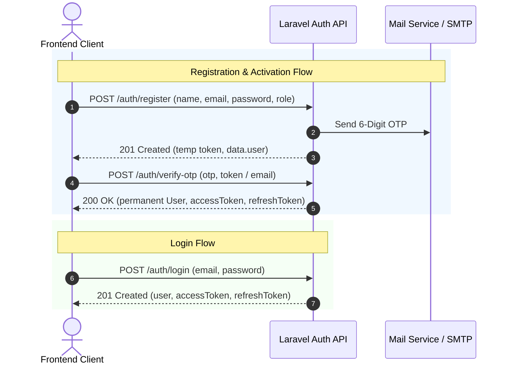
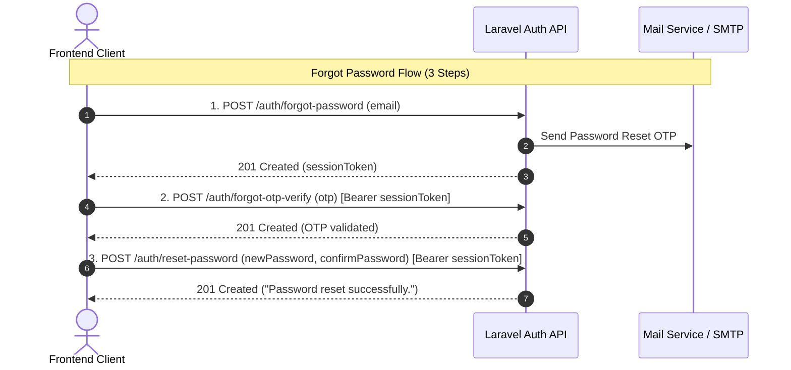

# Authentication API Documentation

Comprehensive guide for integrating authentication into frontend applications (Next.js, React, Vue, React Native, Flutter, and Mobile apps).

---

## 1. Overview & Core Architecture

### Base URL
```http
http://127.0.0.1:1100/api/v1
```
*(In production, replace with your production domain, e.g., `https://api.yourdomain.com/api/v1`)*

### Supported Roles
* **`client`** — Regular customer / end-user.
* **`provider`** — Service provider / vendor (supports `serviceName` and `serviceLisence`).
> [!IMPORTANT]
> For security, the **`admin`** role cannot be self-assigned via public APIs. Any attempt to register or select the `admin` role will be rejected with HTTP 400.

### Token Strategy (Dual Storage)
The API supports both **Bearer Token Headers** and **HttpOnly Cookies**:
1. **Authorization Header (Recommended for Mobile / SPA):**
   ```http
   Authorization: Bearer <accessToken>
   ```
2. **HttpOnly Cookies (Automatic for Web Browsers):**
   - `token` (Access token, expires in 24 hours)
   - `refreshToken` (Refresh token, expires in 365 days)
   - Cookie flags: `SameSite=Lax`, `HttpOnly=true`, `Secure=true` (in production).

---

## 2. Standard API Response Formats

### Success Response Envelope
Every successful response returns the following JSON structure:
```json
{
  "statusCode": 200,
  "success": true,
  "message": "Operation completed successfully.",
  "results": { ... }
}
```

For paginated responses, an optional `meta` object is included:
```json
{
  "statusCode": 200,
  "success": true,
  "message": "Items retrieved successfully.",
  "meta": {
    "currentPage": 1,
    "limit": 10,
    "totalResult": 100,
    "totalPages": 10
  },
  "results": [ ... ]
}
```

### Validation Error Envelope (HTTP 400)
When request payload validation fails:
```json
{
  "statusCode": 400,
  "success": false,
  "message": "Validation Error",
  "errorMessages": [
    {
      "path": "email",
      "message": "Invalid email"
    },
    {
      "path": "password",
      "message": "Password must be at least 6 characters"
    }
  ]
}
```

### Business / Exception Error Envelope (HTTP 400 / 401 / 403 / 404)
```json
{
  "statusCode": 401,
  "success": false,
  "message": "Invalid credentials or token expired.",
  "errorMessages": [
    {
      "path": "",
      "message": "Invalid credentials or token expired."
    }
  ]
}
```

### Rate Limited Error Envelope (HTTP 429)
When request threshold is exceeded:
```json
{
  "statusCode": 429,
  "success": false,
  "message": "Too many requests from this IP, please try again later",
  "errorMessages": [
    {
      "path": "",
      "message": "Too many requests. Please try again later."
    }
  ]
}
```
*HTTP 429 responses include standard headers: `Retry-After: <seconds>`, `X-RateLimit-Limit`, `X-RateLimit-Remaining`.*

---

## 3. Rate Limiting Reference

| Endpoint Route | Method | Rate Limit | Scope / Key |
| :--- | :--- | :--- | :--- |
| `/auth/login` | `POST` | **5 requests / min** | `email + IP` |
| `/auth/register` | `POST` | **10 requests / min** | `IP` |
| `/auth/verify-otp` | `POST` | **5 requests / min** | `email + IP` |
| `/auth/resend-otp` | `POST` | **3 requests / 10 min** | `email + IP` |
| `/auth/forgot-password` | `POST` | **3 requests / 10 min** | `email + IP` |
| `/auth/forgot-otp-verify` | `POST` | **5 requests / min** | `email + IP` |
| `/auth/reset-password` | `POST` | **5 requests / min** | `email + IP` |
| `/auth/change-password` | `POST` | **5 requests / min** | `user_id + IP` |
| `/auth/google` / `/apple` | `POST` | **10 requests / min** | `IP` |
| `/auth/refresh-token` | `POST` | **15 requests / min** | `token_hash + IP` |
| `/auth/select-role` | `POST/PATCH` | **10 requests / min** | `user_id + IP` |

---

## 4. Authentication Endpoints



---

### 4.1 Register New Account

Creates an unverified staging account and emails a 6-digit OTP code.

* **Endpoint:** `POST /api/v1/auth/register`
* **Headers:** `Content-Type: application/json`
* **Rate Limit:** 10 requests / min

#### Request Payload
```json
{
  "name": "Jane Doe",
  "email": "jane@example.com",
  "password": "Password123!",
  "confirmPassword": "Password123!",
  "role": "client",
  "phoneNumber": "+1234567890",
  "address": "123 Market Street",
  "gender": "female"
}
```

> **Provider Fields (Optional for `role: "provider"`):**
> * `serviceName`: string (e.g. `"Plumbing Masters"`)
> * `serviceLisence`: string (e.g. `"LIC-987654"`)

#### Success Response (`HTTP 201 Created`)
```json
{
  "statusCode": 201,
  "success": true,
  "message": "OTP has been sent to your email address. Please verify it to activate your account.",
  "results": {
    "user": {
      "_id": "1",
      "id": "1",
      "email": "jane@example.com",
      "name": "Jane Doe",
      "role": "client"
    },
    "role": "client",
    "token": "eyJhbGciOiJIUzI1NiIsInR5cCI6IkpXVCJ9..."
  }
}
```
*Store `results.token` in memory/state to pass in the next step (`/verify-otp`). In local development, `results.otp` may also be returned for convenience.*

---

### 4.2 Verify OTP (Account Activation)

Activates the account and promotes the user to a permanent active user.

* **Endpoint:** `POST /api/v1/auth/verify-otp`
* **Headers:**
  - `Content-Type: application/json`
  - `Authorization: Bearer <tokenFromRegistration>` *(or pass `email` in body)*
* **Rate Limit:** 5 requests / min

#### Request Payload
```json
{
  "otp": "482910",
  "email": "jane@example.com"
}
```

#### Success Response (`HTTP 200 OK`)
```json
{
  "statusCode": 200,
  "success": true,
  "message": "Account activated successfully.",
  "results": {
    "user": {
      "_id": "1",
      "id": "1",
      "name": "Jane Doe",
      "email": "jane@example.com",
      "profileUrl": "",
      "role": "client",
      "phoneNumber": "+1234567890",
      "address": "123 Market Street",
      "gender": "female",
      "isDeleted": false,
      "status": "active",
      "isVerified": true,
      "isProfileCompleted": false,
      "provider": null,
      "providerId": null,
      "createdAt": "2026-11-04T08:00:00.000000Z",
      "updatedAt": "2026-11-04T08:00:00.000000Z"
    },
    "role": "client",
    "token": "eyJhbGciOiJIUzI1NiIsInR5cCI6IkpXVCJ9.accessToken...",
    "refreshToken": "eyJhbGciOiJIUzI1NiIsInR5cCI6IkpXVCJ9.refreshToken..."
  }
}
```

---

### 4.3 Resend Verification OTP

Resends a new OTP code if the previous one expired or was not received.

* **Endpoint:** `POST /api/v1/auth/resend-otp`
* **Headers:** `Content-Type: application/json`
* **Rate Limit:** 3 requests / 10 min

#### Request Payload
```json
{
  "email": "jane@example.com"
}
```

#### Success Response (`HTTP 201 Created`)
```json
{
  "statusCode": 201,
  "success": true,
  "message": "Otp send successfully. Please check your email.",
  "results": {
    "otp": null
  }
}
```

---

### 4.4 Login

Authenticates user via email and password, issuing access & refresh tokens.

* **Endpoint:** `POST /api/v1/auth/login`
* **Headers:** `Content-Type: application/json`
* **Rate Limit:** 5 requests / min

#### Request Payload
```json
{
  "email": "jane@example.com",
  "password": "Password123!"
}
```

#### Success Response (`HTTP 201 Created`)
```json
{
  "statusCode": 201,
  "success": true,
  "message": "Login successfully.",
  "results": {
    "user": {
      "_id": "1",
      "id": "1",
      "name": "Jane Doe",
      "email": "jane@example.com",
      "profileUrl": "",
      "role": "client",
      "phoneNumber": "+1234567890",
      "address": "123 Market Street",
      "gender": "female",
      "isDeleted": false,
      "status": "active",
      "isVerified": true,
      "isProfileCompleted": false,
      "provider": null,
      "providerId": null,
      "createdAt": "2026-11-04T08:00:00.000000Z",
      "updatedAt": "2026-11-04T08:00:00.000000Z"
    },
    "role": "client",
    "token": "eyJhbGciOiJIUzI1NiIsInR5cCI6IkpXVCJ9.eyJpZCI6IjEiLCJlbWFpbCI6ImphbmVAZXhhbXBsZS5jb20iLCJyb2xlIjoiY2xpZW50In0...",
    "refreshToken": "eyJhbGciOiJIUzI1NiIsInR5cCI6IkpXVCJ9.refreshToken..."
  }
}
```

---

### 4.5 Refresh Access Token

Issues a fresh access token when the current token expires.

* **Endpoint:** `POST /api/v1/auth/refresh-token`
* **Headers:** `Content-Type: application/json`
* **Rate Limit:** 15 requests / min

#### Request Payload
```json
{
  "refreshToken": "eyJhbGciOiJIUzI1NiIsInR5cCI6IkpXVCJ9.refreshToken..."
}
```
*(Also accepts refresh token via `Authorization: Bearer <refreshToken>` header or `refreshToken` cookie).*

#### Success Response (`HTTP 200 OK`)
```json
{
  "statusCode": 200,
  "success": true,
  "message": "Token refreshed successfully.",
  "results": {
    "token": "eyJhbGciOiJIUzI1NiIsInR5cCI6IkpXVCJ9.newAccessToken...",
    "refreshToken": "eyJhbGciOiJIUzI1NiIsInR5cCI6IkpXVCJ9.newRefreshToken...",
    "user": {
      "_id": "1",
      "id": "1",
      "name": "Jane Doe",
      "email": "jane@example.com",
      "role": "client"
    }
  }
}
```

---

### 4.6 Get Current User Profile (`/me`)

Retrieves profile data of the currently logged-in user.

* **Endpoint:** `GET /api/v1/auth/me`
* **Headers:** `Authorization: Bearer <accessToken>`

#### Success Response (`HTTP 200 OK`)
```json
{
  "statusCode": 200,
  "success": true,
  "message": "User profile retrieved successfully.",
  "results": {
    "_id": "1",
    "id": "1",
    "name": "Jane Doe",
    "email": "jane@example.com",
    "profileUrl": "https://example.com/avatar.jpg",
    "role": "client",
    "phoneNumber": "+1234567890",
    "address": "123 Market Street",
    "gender": "female",
    "isDeleted": false,
    "status": "active",
    "isVerified": true,
    "isProfileCompleted": true,
    "provider": null,
    "providerId": null,
    "createdAt": "2026-11-04T08:00:00.000000Z",
    "updatedAt": "2026-11-04T08:00:00.000000Z"
  }
}
```

---

### 4.7 Select / Switch Role

Allows a client or provider to select their active role.

* **Endpoint:** `POST /api/v1/auth/select-role` *(also accepts `PATCH`)*
* **Headers:**
  - `Content-Type: application/json`
  - `Authorization: Bearer <accessToken>` *(optional if passing `email` or `userId`)*
* **Rate Limit:** 10 requests / min

#### Request Payload
```json
{
  "role": "provider"
}
```
*(Acceptable values: `"client"`, `"provider"`. `"admin"` is strictly prohibited).*

#### Success Response (`HTTP 200 OK`)
```json
{
  "statusCode": 200,
  "success": true,
  "message": "Role updated successfully.",
  "results": {
    "user": {
      "_id": "1",
      "id": "1",
      "name": "Jane Doe",
      "email": "jane@example.com",
      "role": "provider"
    },
    "role": "provider",
    "token": "eyJhbGciOiJIUzI1NiIsInR5cCI6IkpXVCJ9.newAccessTokenWithUpdatedRole..."
  }
}
```

---

## 5. Password Management Flows



### 5.1 Step 1: Request Password Reset OTP
* **Endpoint:** `POST /api/v1/auth/forgot-password`
* **Headers:** `Content-Type: application/json`
* **Rate Limit:** 3 requests / 10 min

```json
{
  "email": "jane@example.com"
}
```
**Response (`HTTP 201 Created`):**
```json
{
  "statusCode": 201,
  "success": true,
  "message": "Otp send successfully. Please check your email to reset password.",
  "results": {
    "token": "eyJhbGciOiJIUzI1NiIsInR5cCI6IkpXVCJ9.resetSessionToken..."
  }
}
```
*Save `results.token` for Step 2 and Step 3.*

---

### 5.2 Step 2: Verify Forgot Password OTP
* **Endpoint:** `POST /api/v1/auth/forgot-otp-verify`
* **Headers:**
  - `Content-Type: application/json`
  - `Authorization: Bearer <resetSessionToken>`
* **Rate Limit:** 5 requests / min

```json
{
  "otp": "729401"
}
```
**Response (`HTTP 201 Created`):**
```json
{
  "statusCode": 201,
  "success": true,
  "message": "Opt verified successfully. Please reset your password.",
  "results": null
}
```

---

### 5.3 Step 3: Set New Password
* **Endpoint:** `POST /api/v1/auth/reset-password`
* **Headers:**
  - `Content-Type: application/json`
  - `Authorization: Bearer <resetSessionToken>`
* **Rate Limit:** 5 requests / min

```json
{
  "newPassword": "NewStrongPassword456!",
  "confirmPassword": "NewStrongPassword456!"
}
```
**Response (`HTTP 201 Created`):**
```json
{
  "statusCode": 201,
  "success": true,
  "message": "Password reset successfully.",
  "results": {
    "message": "Password reset successful"
  }
}
```

---

### 5.4 Authenticated Password Change
For logged-in users who want to change their password from their profile settings.

* **Endpoint:** `POST /api/v1/auth/change-password`
* **Headers:**
  - `Content-Type: application/json`
  - `Authorization: Bearer <accessToken>`
* **Rate Limit:** 5 requests / min

```json
{
  "oldPassword": "CurrentPassword123!",
  "newPassword": "NewPassword789!",
  "confirmPassword": "NewPassword789!"
}
```
**Response (`HTTP 201 Created`):**
```json
{
  "statusCode": 201,
  "success": true,
  "message": "Password changed successfully.",
  "results": {
    "message": "Password changed successfully"
  }
}
```

---

## 6. Social Authentication (Google & Apple)

### 6.1 Google Sign-In (Native Mobile / Single-Page App)
Used when your frontend obtains an `idToken` from Google SDK (e.g. Google Sign-In on iOS/Android, `@react-oauth/google`).

* **Endpoint:** `POST /api/v1/auth/google`
* **Headers:** `Content-Type: application/json`
* **Rate Limit:** 10 requests / min

#### Request Payload
```json
{
  "idToken": "eyJhbGciOiJSUzI1NiIsImtpZCI6...",
  "role": "client"
}
```
*(Accepts `"idToken"`, `"identityToken"`, or `"token"`. `role` defaults to `"client"`).*

#### Success Response (`HTTP 200 OK`)
```json
{
  "statusCode": 200,
  "success": true,
  "message": "Google sign-in successful.",
  "results": {
    "user": {
      "_id": "2",
      "id": "2",
      "name": "Jane Google",
      "email": "jane@gmail.com",
      "profileUrl": "https://lh3.googleusercontent.com/...",
      "role": "client",
      "status": "active",
      "isVerified": true,
      "provider": "google",
      "providerId": "109876543210987654321"
    },
    "accessToken": "eyJhbGciOiJIUzI1NiIsInR5cCI6IkpXVCJ9...",
    "token": "eyJhbGciOiJIUzI1NiIsInR5cCI6IkpXVCJ9...",
    "refreshToken": "eyJhbGciOiJIUzI1NiIsInR5cCI6IkpXVCJ9..."
  }
}
```

---

### 6.2 Google Web OAuth Redirect Flow (Browser)
For traditional web applications without a client-side Google SDK:
1. **Initiate Login:**
   Redirect user's browser to:
   ```http
   GET http://127.0.0.1:1100/api/v1/auth/google?role=client
   ```
2. **Google Authentication:**
   User logs in on Google's consent screen.
3. **Frontend Callback Redirect:**
   Google redirects back to backend callback, and backend redirects to frontend with tokens in URL:
   ```http
   http://localhost:3000/auth/callback?token=<accessToken>&refreshToken=<refreshToken>
   ```

---

### 6.3 Apple Sign-In (iOS / Native Mobile / Web)
Used when your application receives an `identityToken` from Apple Authentication Services.

* **Endpoint:** `POST /api/v1/auth/apple`
* **Headers:** `Content-Type: application/json`
* **Rate Limit:** 10 requests / min

#### Request Payload
```json
{
  "identityToken": "eyJraWQiOiJlWGFtcGxl...",
  "role": "client",
  "fullName": "Jane Doe"
}
```

#### Success Response (`HTTP 200 OK`)
```json
{
  "statusCode": 200,
  "success": true,
  "message": "Apple sign-in successful.",
  "results": {
    "user": {
      "_id": "3",
      "id": "3",
      "name": "Jane Doe",
      "email": "jane@privaterelay.appleid.com",
      "role": "client",
      "status": "active",
      "isVerified": true,
      "provider": "apple",
      "providerId": "001234.apple.user.id"
    },
    "accessToken": "eyJhbGciOiJIUzI1NiIsInR5cCI6IkpXVCJ9...",
    "token": "eyJhbGciOiJIUzI1NiIsInR5cCI6IkpXVCJ9...",
    "refreshToken": "eyJhbGciOiJIUzI1NiIsInR5cCI6IkpXVCJ9..."
  }
}
```

---

## 7. Frontend Integration Code Examples

### 7.1 TypeScript Interfaces (`types/auth.ts`)

```typescript
export type UserRole = 'client' | 'provider' | 'admin';

export interface User {
  _id: string;
  id: string;
  name: string;
  email: string;
  profileUrl?: string;
  role: UserRole;
  phoneNumber?: string;
  address?: string;
  gender?: 'male' | 'female' | 'other' | null;
  status: 'active' | 'pending' | 'suspended' | 'deleted';
  isVerified: boolean;
  isProfileCompleted: boolean;
  provider?: string | null;
  providerId?: string | null;
  serviceName?: string;
  serviceLisence?: string;
  createdAt: string;
  updatedAt: string;
}

export interface ApiResponse<T = any> {
  statusCode: number;
  success: boolean;
  message: string;
  data: T;
  errorMessages?: Array<{ path: string; message: string }>;
}

export interface AuthTokens {
  token: string;
  refreshToken: string;
}

export interface LoginResponseData {
  user: User;
  role: UserRole;
  token: string;
  refreshToken: string;
}
```

---

### 7.2 Production Axios Client with Auto-Refresh Interceptor (`lib/apiClient.ts`)

This setup automatically:
1. Attaches the `Authorization: Bearer <token>` to outgoing requests.
2. Catches HTTP `401 Unauthorized` responses.
3. Automatically requests a new access token via `/auth/refresh-token`.
4. Retries the original request seamlessly without logging the user out.

```typescript
import axios, { AxiosError, InternalAxiosRequestConfig } from 'axios';
import { ApiResponse, AuthTokens } from '../types/auth';

const API_BASE_URL = process.env.NEXT_PUBLIC_API_URL || 'http://127.0.0.1:1100/api/v1';

export const apiClient = axios.create({
  baseURL: API_BASE_URL,
  headers: {
    'Content-Type': 'application/json',
    Accept: 'application/json',
  },
  withCredentials: true, // Enables automatic HttpOnly cookie transmission
});

// Helper functions for token storage (localStorage / SecureStore)
export const tokenStorage = {
  getAccessToken: () => (typeof window !== 'undefined' ? localStorage.getItem('accessToken') : null),
  getRefreshToken: () => (typeof window !== 'undefined' ? localStorage.getItem('refreshToken') : null),
  setTokens: (access: string, refresh: string) => {
    if (typeof window !== 'undefined') {
      localStorage.setItem('accessToken', access);
      localStorage.setItem('refreshToken', refresh);
    }
  },
  clearTokens: () => {
    if (typeof window !== 'undefined') {
      localStorage.removeItem('accessToken');
      localStorage.removeItem('refreshToken');
    }
  },
};

// 1. Request Interceptor: Attach Bearer Token
apiClient.interceptors.request.use((config: InternalAxiosRequestConfig) => {
  const token = tokenStorage.getAccessToken();
  if (token && !config.headers.Authorization) {
    config.headers.Authorization = `Bearer ${token}`;
  }
  return config;
});

// 2. Response Interceptor: Handle Automatic Token Refresh on 401
let isRefreshing = false;
let failedQueue: Array<{
  resolve: (token: string) => void;
  reject: (err: any) => void;
}> = [];

const processQueue = (error: any, token: string | null = null) => {
  failedQueue.forEach((promise) => {
    if (error) {
      promise.reject(error);
    } else {
      promise.resolve(token!);
    }
  });
  failedQueue = [];
};

apiClient.interceptors.response.use(
  (response) => response,
  async (error: AxiosError<ApiResponse>) => {
    const originalRequest = error.config as InternalAxiosRequestConfig & { _retry?: boolean };

    // If 401 occurs and request hasn't been retried yet
    if (error.response?.status === 401 && !originalRequest._retry) {
      if (originalRequest.url?.includes('/auth/refresh-token') || originalRequest.url?.includes('/auth/login')) {
        tokenStorage.clearTokens();
        return Promise.reject(error);
      }

      if (isRefreshing) {
        return new Promise((resolve, reject) => {
          failedQueue.push({ resolve, reject });
        })
          .then((newToken) => {
            originalRequest.headers.Authorization = `Bearer ${newToken}`;
            return apiClient(originalRequest);
          })
          .catch((err) => Promise.reject(err));
      }

      originalRequest._retry = true;
      isRefreshing = true;

      const refreshToken = tokenStorage.getRefreshToken();
      if (!refreshToken) {
        tokenStorage.clearTokens();
        isRefreshing = false;
        return Promise.reject(error);
      }

      try {
        const { data } = await axios.post<ApiResponse<AuthTokens>>(
          `${API_BASE_URL}/auth/refresh-token`,
          { refreshToken },
          { headers: { 'Content-Type': 'application/json' } }
        );

        const newAccessToken = data.results.token;
        const newRefreshToken = data.data.refreshToken;

        tokenStorage.setTokens(newAccessToken, newRefreshToken);
        apiClient.defaults.headers.common.Authorization = `Bearer ${newAccessToken}`;
        processQueue(null, newAccessToken);

        originalRequest.headers.Authorization = `Bearer ${newAccessToken}`;
        return apiClient(originalRequest);
      } catch (refreshErr) {
        processQueue(refreshErr, null);
        tokenStorage.clearTokens();
        // Redirect to login page if desired
        if (typeof window !== 'undefined') {
          window.location.href = '/login';
        }
        return Promise.reject(refreshErr);
      } finally {
        isRefreshing = false;
      }
    }

    return Promise.reject(error);
  }
);
```

---

### 7.3 Complete React / Next.js Auth Service Hook Example (`services/authService.ts`)

```typescript
import { apiClient, tokenStorage } from '../lib/apiClient';
import { ApiResponse, LoginResponseData, User } from '../types/auth';

export const authService = {
  // 1. Register
  register: async (payload: {
    name: string;
    email: string;
    password: string;
    confirmPassword: string;
    role?: 'client' | 'provider';
  }) => {
    const res = await apiClient.post<ApiResponse<{ user: User; token: string }>>('/auth/register', payload);
    return res.data;
  },

  // 2. Verify OTP
  verifyOtp: async (otp: string, email: string, registrationToken?: string) => {
    const headers = registrationToken ? { Authorization: `Bearer ${registrationToken}` } : {};
    const res = await apiClient.post<ApiResponse<LoginResponseData>>(
      '/auth/verify-otp',
      { otp, email },
      { headers }
    );
    if (res.data.success && res.data.results.token) {
      tokenStorage.setTokens(res.data.results.token, res.data.data.refreshToken);
    }
    return res.data;
  },

  // 3. Login
  login: async (email: string, password: string) => {
    const res = await apiClient.post<ApiResponse<LoginResponseData>>('/auth/login', {
      email,
      password,
    });
    if (res.data.success && res.data.results.token) {
      tokenStorage.setTokens(res.data.results.token, res.data.data.refreshToken);
    }
    return res.data;
  },

  // 4. Get Current User Profile
  getProfile: async () => {
    const res = await apiClient.get<ApiResponse<User>>('/auth/me');
    return res.data.data;
  },

  // 5. Logout
  logout: () => {
    tokenStorage.clearTokens();
    if (typeof window !== 'undefined') {
      window.location.href = '/login';
    }
  },
};
```

---

## 8. Common Integration Questions (FAQ)

### Q1: Why am I getting HTTP 429 "Too many requests"?
**Answer:** The request exceeded our distributed rate limiter. Check the `Retry-After` header in the HTTP response; it contains the exact number of seconds you must wait before retrying (e.g. 60 seconds). Implement a frontend countdown timer or disable the submit button during this period.

### Q2: Why did `/select-role` reject `"admin"`?
**Answer:** The API enforces a strict role policy where admin accounts can only be provisioned internally. Only `"client"` or `"provider"` roles are accepted.

### Q3: Do I need to store the tokens if my frontend uses cookies?
**Answer:** The backend sets `token` and `refreshToken` in HttpOnly cookies automatically. If your frontend and backend share the domain or configure CORS credentials (`withCredentials: true`), cookies work out of the box. For mobile apps (iOS/Android), store `token` and `refreshToken` in SecureStore/Keychain and send via the `Authorization: Bearer <token>` header.


