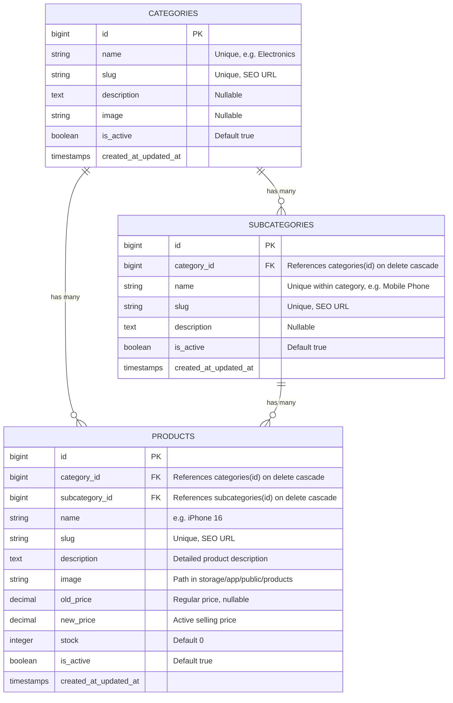
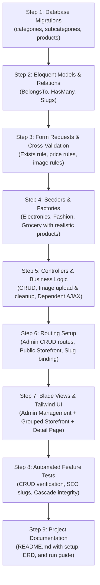

# Technical Assignment: E-Commerce Platform Development
## Project Specification & Step-by-Step Implementation Flow

---

## 1. Project Overview & Objective

The objective of this assignment is to develop a functional **E-Commerce Platform** using **Laravel (PHP 8.3) and PostgreSQL**. The platform features complete CRUD operations for Categories, Subcategories, and Products, along with a customer-facing storefront that presents products organized by their respective subcategories and accessible through SEO-friendly slug URLs.

### Core Stack
* **Backend Framework:** Laravel 11/12/13 (PHP 8.3)
* **Database:** PostgreSQL (with Eloquent ORM & strict foreign key cascades)
* **API Architecture:** Centralized `ApiResponse` trait (`statusCode`, `success`, `message`, `results`, optional `meta`)
* **Frontend:** Laravel Blade + Tailwind CSS + Vanilla JS (for dynamic dependent dropdowns)
* **Storage:** Laravel Public Disk (`storage/app/public` linked via `php artisan storage:link`)
* **Testing:** PHPUnit Automated Feature & Unit Test Suite

---

## 2. Entity Relational Architecture



---

## 3. Step-by-Step Implementation Roadmap



---

### Step 1: Database Migrations

Create 3 database migrations with proper indexing and foreign key constraints:

1. **`create_categories_table`**:
   - `id`: bigIncrements
   - `name`: string (unique)
   - `slug`: string (unique, indexed)
   - `description`: text (nullable)
   - `image`: string (nullable)
   - `is_active`: boolean (default `true`)
   - `timestamps`

2. **`create_subcategories_table`**:
   - `id`: bigIncrements
   - `category_id`: foreignId constrained to `categories` with `onDelete('cascade')`
   - `name`: string
   - `slug`: string (unique, indexed)
   - `description`: text (nullable)
   - `is_active`: boolean (default `true`)
   - `timestamps`

3. **`create_products_table`**:
   - `id`: bigIncrements
   - `category_id`: foreignId constrained to `categories` with `onDelete('cascade')`
   - `subcategory_id`: foreignId constrained to `subcategories` with `onDelete('cascade')`
   - `name`: string
   - `slug`: string (unique, indexed)
   - `description`: longText
   - `image`: string (nullable or required on create)
   - `old_price`: decimal(12, 2) nullable
   - `new_price`: decimal(12, 2)
   - `stock`: integer (default 0)
   - `is_active`: boolean (default `true`)
   - `timestamps`

---

### Step 2: Eloquent Models & Relationships

1. **`Category.php`**:
   - Relations:
     - `subcategories()`: `hasMany(Subcategory::class)`
     - `products()`: `hasMany(Product::class)`
   - Route Model Binding: uses `slug` (`getRouteKeyName() => 'slug'`)
   - Automatically generates slug on saving if not provided

2. **`Subcategory.php`**:
   - Relations:
     - `category()`: `belongsTo(Category::class)`
     - `products()`: `hasMany(Product::class)`
   - Route Model Binding: uses `slug`

3. **`Product.php`**:
   - Relations:
     - `category()`: `belongsTo(Category::class)`
     - `subcategory()`: `belongsTo(Subcategory::class)`
   - Attributes / Accessors:
     - `image_url`: returns asset URL for public storage or placeholder if null
     - `discount_percentage`: calculates discount percentage if `old_price` is present
     - `is_on_sale`: boolean check if `old_price > new_price`
   - Route Model Binding: uses `slug`

---

### Step 3: Form Requests & Cross-Validation

Build dedicated Form Request classes for each entity to ensure clean controllers:

1. **Category Validation**:
   - `StoreCategoryRequest`: `name` required|string|max:255|unique:categories, `description` nullable|string, `image` nullable|image|max:2048
   - `UpdateCategoryRequest`: same, but ignoring current ID for unique `name` rule

2. **Subcategory Validation**:
   - `StoreSubcategoryRequest`: `category_id` required|exists:categories,id, `name` required|string|max:255, `description` nullable|string
   - `UpdateSubcategoryRequest`: same, ignoring current ID

3. **Product Validation**:
   - `StoreProductRequest`:
     - `category_id`: `required|exists:categories,id`
     - `subcategory_id`: `required|exists:subcategories,id` + **Cross-Validation Rule** ensuring the subcategory belongs to the selected category:
       ```php
       Rule::exists('subcategories', 'id')->where('category_id', $this->category_id)
       ```
     - `name`: `required|string|max:255`
     - `description`: `required|string`
     - `image`: `required|image|mimes:jpeg,png,jpg,webp|max:2048`
     - `old_price`: `nullable|numeric|min:0`
     - `new_price`: `required|numeric|min:0`
   - `UpdateProductRequest`:
     - Same rules, but `image` is `nullable|image|...` (preserves existing image if not re-uploaded)

---

### Step 4: Seeders & Factories (Demo Catalog)

Create realistic, ready-to-evaluate seed data:
* **Category 1: Electronics**
  * Subcategory: *Mobile Phone* $\rightarrow$ Products: iPhone 16 (Old: ৳120,000, New: ৳110,000), Samsung Galaxy S24 Ultra
  * Subcategory: *Laptop* $\rightarrow$ Products: MacBook Pro M3, Dell XPS 15
* **Category 2: Fashion**
  * Subcategory: *Men's Clothing* $\rightarrow$ Products: Casual Slim Fit Shirt, Denim Jacket
  * Subcategory: *Shoes* $\rightarrow$ Products: Leather Loafers, Running Sneakers
* **Category 3: Grocery**
  * Subcategory: *Beverages* $\rightarrow$ Products: Premium Coffee Beans, Green Tea

Running `php artisan migrate:fresh --seed` will immediately populate a functional store.

---

### Step 5: Controllers & File Operations

1. **`CategoryController`**:
   - `index`: lists categories with subcategories count & products count
   - `create` & `store`: handles creation with slug generation
   - `edit` & `update`: updates category details and slug
   - `destroy`: deletes category and cascades related subcategories and products

2. **`SubcategoryController`**:
   - `index`: lists subcategories with their parent category name
   - `create` & `store`: selects parent category, creates subcategory
   - `edit` & `update`: updates subcategory details
   - `destroy`: deletes subcategory
   - `byCategory($categoryId)`: JSON endpoint returning subcategories for AJAX dynamic dropdown

3. **`ProductController`**:
   - `index`: paginated data table with search & filter by category/subcategory
   - `create` & `store`: handles image upload to `products/`, stores prices and relationships
   - `edit` & `update`: updates product details, replaces image file on disk if a new image is uploaded
   - `destroy`: removes product and deletes image from storage

4. **`StorefrontController` (Public Catalog & SEO Details)**:
   - `index`: fetches all active products **grouped by their respective subcategories** (`$products->groupBy('subcategory.name')`)
   - `show($slug)`: loads single product by slug with category and subcategory relationships for the details page

---

### Step 6: Routing Architecture

#### A. Admin Routes (`/admin`)
```php
Route::prefix('admin')->name('admin.')->group(function () {
    // Categories CRUD
    Route::resource('categories', CategoryController::class);

    // Subcategories CRUD & Dynamic Filter
    Route::resource('subcategories', SubcategoryController::class);
    Route::get('categories/{category}/subcategories', [SubcategoryController::class, 'byCategory'])
        ->name('categories.subcategories');

    // Products CRUD
    Route::resource('products', ProductController::class);
});
```

#### B. Public Storefront Routes (`/`)
```php
// 1. Grouped Product Listing Page
Route::get('/', [StorefrontController::class, 'index'])->name('storefront.index');

// 2. SEO-Friendly Product Details Page
Route::get('/product/{product:slug}', [StorefrontController::class, 'show'])->name('storefront.product');
```

---

### Step 7: Blade Views & Frontend Layout

1. **Main Layout (`layouts/app.blade.php`)**:
   - Modern Tailwind navbar with links to Storefront Catalog and Admin Dashboard
   - Flash message banner for success/error alerts
   - Mobile-responsive navigation

2. **Admin Management Views**:
   - **Categories**: Data table with Name, Slug, Subcategories Count, Products Count, Actions (Edit/Delete) + Create Modal/Page.
   - **Subcategories**: Data table showing Subcategory Name, Parent Category Badge, Products Count, Actions + Create/Edit Form.
   - **Products**: Data table with thumbnail, Title, Category Badge, Subcategory Badge, Old Price, New Price, Status, Actions.
   - **Product Create/Edit Form**:
     - Category dropdown
     - Subcategory dropdown with **Dynamic AJAX Fetch**:
       ```javascript
       document.getElementById('category_id').addEventListener('change', async function() {
           const res = await fetch(`/admin/categories/${this.value}/subcategories`);
           const subcategories = await res.json();
           // Populates subcategory options seamlessly
       });
       ```
     - Image file upload with instant client-side preview

3. **Customer Storefront Views**:
   - **Product Listing Page (`storefront/index.blade.php`)**:
     - Organized and grouped into distinct sections by **Subcategory**.
     - Product cards featuring: Image, Title, Category/Subcategory badge, Old Price (strikethrough), New Price, Discount tag, and "View Details" button.
   - **Product Details Page (`storefront/show.blade.php`)**:
     - SEO Breadcrumb navigation (`Home > Category > Subcategory > Product Name`)
     - Large product image preview
     - Price comparison block (`Old: ৳120,000`, `Now: ৳110,000`, `Save ৳10,000`)
     - Full markdown/text product description
     - Direct button to return to catalog

---

### Step 8: Automated Feature & Unit Tests

Write comprehensive test coverage using PHPUnit:
* `CategoryCrudTest`: verifies create, validation, duplicate slug prevention, update, and delete.
* `SubcategoryCrudTest`: verifies creation under category, `belongsTo` relationship, and cascade delete.
* `ProductCrudTest`: verifies creation, image upload to disk, cross-validation (cannot select mismatching subcategory), and update/delete.
* `StorefrontTest`: verifies products are properly grouped by subcategories on `/`, and accessible via `/product/{slug}`.

---

### Step 9: Documentation & Submission Polish

* Update `README.md` with:
  - Project Overview
  - Database Schema & ERD
  - Setup & installation commands (`composer install`, `php artisan migrate --seed`, `php artisan storage:link`, `php artisan serve`)
  - Features overview & routing table
  - Automated test instructions (`php artisan test`)

